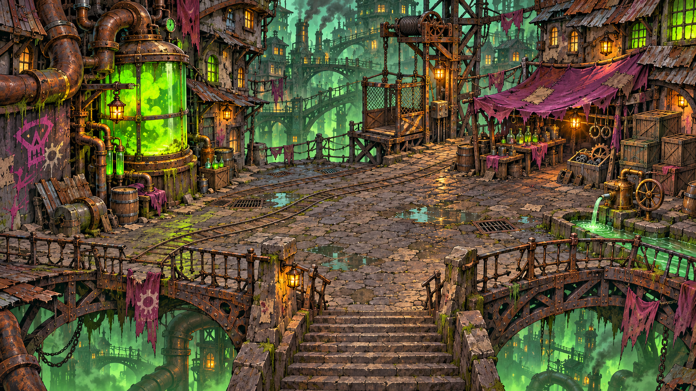

# Gutterlight

A painterly 2D undercity where an autonomous character, Iona, explores interconnected streets, learns practical skills, and carries experiences into later choices.

**[Play the hosted prototype](https://mosslight-foundry-lanes.rustylapis6.chatgpt.site/)**



## Run locally

Requires **Node.js 20 or newer**. No dependencies, API keys, build step, or hosted account are needed.

```sh
git clone https://github.com/pink-cupcakes/Gutterlight.git
cd Gutterlight
npm start
```

Open **http://localhost:3000**. To use another port: `PORT=8080 npm start`.

## Play

- **Watch Iona** lets her choose where to go and what to try.
- **WASD / arrow keys** or **click / tap** moves her directly; **Shift** moves faster.
- **E** interacts; **J** opens the journal; **B** the satchel; **M** the map; **G** visitor gifts.
- **Journal → Becoming** shows ongoing concerns, relationships, evidence behind beliefs, unfinished work, and playable sound sketches.
- Walking off an open street leads to another neighborhood. The streets themselves form a maze of branches, loops, shortcuts, and dead ends.

There are seven painted neighborhoods, four residents, combinable skills, interactive machinery, and small problems with lasting consequences. Follow-ups mature over real minutes, hours, and days.

## How her life works

Iona uses a **local, rule-based planner with authored narrative possibilities**, not a live language model. She remembers discovered objects and routes, combines skills and materials, experiments with mechanisms, and gradually changes preferences through recorded experience. Relationships and unfinished creative work persist across visits.

Each browser has its own world. Saves stay in local storage; visitors do not share one Iona, and there is no server simulation or cross-device sync. Time away matures concerns, but actions and conversations occur only while the page is open. Export a save from **Journal → World history → Export world history** before clearing browser data. The hosted version and a local copy have separate saves because they use different origins.

The hosted prototype keeps its existing URL. This repository uses the Gutterlight name; the original browser storage key is retained for save compatibility.

## Development

```sh
npm test
```

Tests cover navigation, guarded world actions, resources, save migration, planning, character continuity across simulated days, and the actual update loop. Browser visual verification was unavailable in the original managed environment.

- `dist/` — complete static game, including all generated artwork.
- `tests/` — Node.js automated tests.
- `scripts/serve.js` — dependency-free local HTTP server.
- [Architecture and design notes](docs/architecture.md) — world, planning, memory, and timing details.

To deploy independently, upload the **contents of `dist/`** to a static web host. Keep its directory structure intact. No rewrite rules or secrets are required. Google Fonts are optional; fallback fonts work without them.

## Artwork and inspiration

The bundled environments, character sprites, residents, and inventory art were generated with GPT image tools for this project. The visual direction is an industrial steampunk undercity. Pino’s public character project informed the emphasis on persistent memory and unfinished concerns; Gutterlight’s implementation and fictional events are its own.
